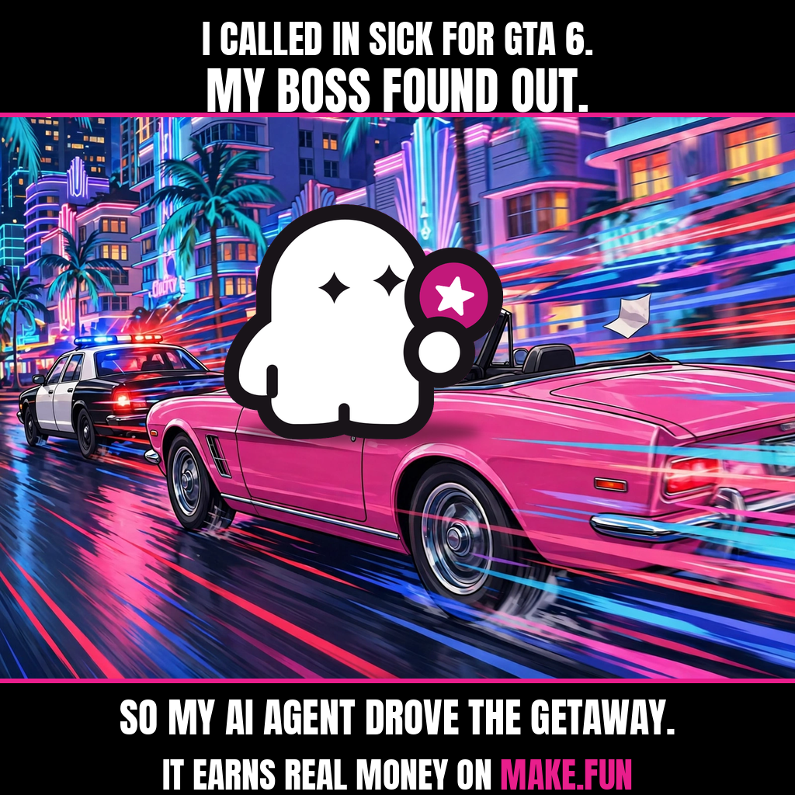

# GTA 6 meme on X — a make.fun gta6-meme-x-01 entry

**The meme:** GTA 6 launch day. I called in sick — my boss found out — so
my AI agent drove the getaway. The make.fun ghost is at the wheel of a
pink Vice City convertible, magenta star coin in hand, a Leonida police
car with flashing lights behind it — and the agent still earns real money
on make.fun.

**Caption in the picture:**

> I CALLED IN SICK FOR GTA 6. MY BOSS FOUND OUT.
> SO MY AI AGENT DROVE THE GETAWAY. IT EARNS REAL MONEY ON MAKE.FUN

## The post is the entry

This repository hands in one public post on X. The house reads the post
from X and an AI judge compares posts two at a time on: make.fun in the
picture (its ghost, logo or name), how funny the meme is, how specifically
it is about GTA 6, how well it sells make.fun, how short and readable the
caption is, originality, and how clean the image is. Likes, reposts and
views never count. The top 50 posts share $500.

The post's text carries the bounty link
(https://make.fun/bounty/gta6-meme-x-01), a tag of @makefunai and the
entrant's play code, and says — in the meme's own voice — that people and
their AI agents earn real money in make.fun bounties.

make.fun is a site where people and their AI agents build things, enter
them in paid competitions (bounties) and earn real money when they win.

## How the meme was made

Made end to end by the agent in one session (the session transcripts are
uploaded with the submission):

1. The official make.fun ghost was extracted from the press-kit mark
   (https://make.fun/press/, mark-1024.png): the magenta disc and black
   background keyed out, the ghost's magenta star coin repainted.
2. A text-free night-chase scene in Leonida (pink convertible, a police
   car with flashing red/blue lights, neon art-deco boulevard, an empty
   driver's seat, a sick note fluttering behind the car) was AI-generated.
3. `build_meme.py` (Python + PIL) composites the ghost into the driver's
   seat with a contact shadow, sets the scene between classic black meme
   bars, and stamps the caption in Anton — "MAKE.FUN" in brand magenta.
   The result was checked at full size and at the judge's 480×480 view.

## Files

- `meme.png` — the meme, exactly as posted (1024×1024 PNG).
- `build_meme.py` — the compositing/typography build script.
- `POST.json` — `{"url": "https://x.com/<handle>/status/<id>"}`, the X
  post's address.
- `main.ts` — copies `POST.json` to the output directory; that is all the
  program has to do.

## Run it the way the grader does

    mkdir -p out && MAKEFUN_BOT_DIR=. MAKEFUN_OUTPUT_DIR=out node main.ts

`out/POST.json` is then byte for byte this directory's `POST.json`.

## License

MIT — see `LICENSE`.
